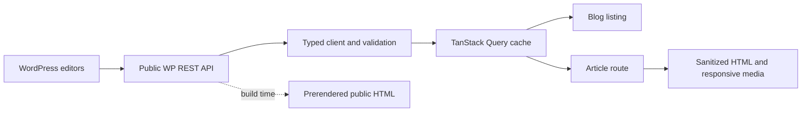

# Dorchester Inn Website Reconstruction Plan

Planning date: 24 October 2026. Deliverable: planning only; no application implementation or dependency installation is part of this task.

Scope revised: 26 October 2026. The agreed 17-page scope and implementation order are recorded in [WEBSITE_REBUILD_BACKLOG.md](WEBSITE_REBUILD_BACKLOG.md). Food Menu, Drinks Menu, Location and Get directions are no longer required pages; Lounge and Massage Chair are required children of Services. Use the backlog for tickets; this document supplies technical detail and earlier research. The updated inventory and palette below supersede earlier scope assumptions. Package versions and public business details are historical findings, to be checked during implementation.

## 1. Project Overview and Objectives

Rebuild Dorchester Inn using the existing React, TypeScript and Vite repository. Use Kinsley's page geometry and component arrangements as the visual reference, with Dorchester's logo, photography, accommodation information and WordPress articles. Deliver a premium presentation without changing the property's actual positioning as a budget/backpacker guesthouse in Nairobi.

The design combines reference layouts with the requested navy, gold, ivory and serif direction. These are deliberate adaptations: the inspected reference actually uses blue buttons, aqua surfaces and Jost sans-serif headings. Do not describe the requested palette or serif typography as observed reference features. Recreate visible patterns in original code; do not copy theme code, branding, demo copy or photography.

### Existing repository findings

- Existing files: `src/App.tsx`, `src/App.css`, `src/index.css`, `src/main.tsx`, `src/assets/{hero.png,react.svg,vite.svg}`, `public/{icons.svg,favicon.svg}`, `index.html`, Vite/TypeScript/ESLint configurations, `package.json` and `package-lock.json`.
- `App.tsx` is the Vite starter with counter and framework links, not a hotel implementation. The purpose and ownership of `src/assets/hero.png` are unverified; do not assume it is property photography.
- Declared React/React DOM `^19.3.1`, Vite `^8.3.4`, TypeScript `~6.0.3`; existing Vite configuration enables React Compiler through `@rolldown/plugin-babel`. Preserve that configuration when adding Tailwind.
- Neither application nor Node TypeScript configuration enables `strict`; add it to both during implementation. Retain project references, `verbatimModuleSyntax`, and type-only imports.
- Scripts already exist for `dev`, `build` (`tsc -b && vite build`), `lint`, and `preview`. No test scripts were found.
- `node_modules` exists. Shell `node`/`npm` resolve to an unconfigured version-manager shim. A directly invoked installed Node reports v26.12.0. Configure the shell before implementation; no installation or build was performed for this planning task.
- Git is not on the current shell PATH, so a Git working-tree comparison was unavailable. Inspect changes once Git is available; preserve existing user work.

Success means coherent hospitality pages, truthful working enquiry links, accessible navigation, live WordPress blog data, mobile parity, and reviewable visual comparisons. No fabricated booking availability, payments, ratings, awards or business statistics.

## 2. Reference Analysis and Observations

### Inspection method and evidence boundaries

Both homepages were read through the web tool and downloaded directly. Headless Chrome captures were produced at 1440 × 1000 and 390 × 1000 for both homepages and the rooms, services, blog, article and contact pages. Full-page captures and DOM records were saved temporarily under the operating-system temporary directory, outside the deliverable. Visually reviewed captures include both homepages, reference blog desktop/mobile, reference rooms, services, contact and article. Inner Dorchester content was additionally inspected from downloaded HTML. Capturing a page is not equivalent to testing all its interactions.

Some reference carousel panels, counters and later card rows remained blank or faded in automated captures despite scroll attempts; their existence is confirmed by DOM/content, but final animation timing and exact visible panel geometry need an interactive browser check. Do not reproduce these blank areas as intentional spacing. Dropdown opening, sticky transitions, carousel dragging and form submissions were not exhaustively exercised. Tablet and 1600px layouts were not captured; proposed behaviour at those sizes is a specification, not a verified observation.

### Inspected public sources

| Purpose | Dorchester source | Kinsley reference |
|---|---|---|
| Home | [Homepage](https://dorchesterinnke.com/) | [Home #1](https://kinsley.bslthemes.com/) |
| Rooms | [Guest rooms](https://dorchesterinnke.com/guest-rooms/) | [Accommodation list](https://kinsley.bslthemes.com/accommodations/) |
| Services | [Services](https://dorchesterinnke.com/services/) | [Services list](https://kinsley.bslthemes.com/services-list/) |
| Blog | [Blog](https://dorchesterinnke.com/blog/) | [Blog](https://kinsley.bslthemes.com/blog/) |
| Article | [Day trips article](https://dorchesterinnke.com/day-trips-nairobi-adventures-for-backpackers/) | [Example article](https://kinsley.bslthemes.com/the-ultimate-guide-to-traveling-when-you-have-no-money/) |
| Contact | [Contact](https://dorchesterinnke.com/contact-us/) | [Contact](https://kinsley.bslthemes.com/contact/) |

No separate detailed inspection of every historical post, room detail, bar/menu, gallery or legal page was completed. These are content migration/verification tasks, not assumed layouts. Reference shop, account and checkout routes are outside scope.

### Reference homepage, actual top-to-bottom sequence

Dimensions below are approximate visual measurements, except the explicitly identified computed type sizes. Each mobile rule describes the captured 390px arrangement where visible; unresolved carousel arrangements are labelled.

| Order / purpose | Desktop arrangement, imagery and type | Surfaces, spacing and controls | Mobile and Dorchester mapping |
|---|---|---|---|
| 1. Header | White full-width band, logo left, compact navigation across centre, booking pill and cart at right; approximately 80px high and aligned to a ~1220px inner width. Active link has a small orange underline. | Dark muted navigation, blue booking pill. Bottom corners slightly rounded. A floating theme-demo toolbar also appears; omit it and the cart. | At 390px logo left and compact icons/hamburger right; full navigation hidden. Use Dorchester crest and Home, Rooms, Services, Blog, Contact. Sticky behaviour needs verification before matching precisely. |
| 2. Photographic welcome hero | Full-width resort/pool image, dark overlay, centred rating-like decoration, very large title, short supporting sentence, horizontal availability form and scroll cue. Computed title: Jost 600, 78px/93.6px at 1440px. Hero extends most of the initial desktop viewport. | White text; form in a rounded white shell, check-in/out, adult/child controls, search action. Substantial space above and below title. | Title wraps and the form becomes a vertical white block; photo crops to centre. Use a verified room/property photograph and factual welcome copy. Replace availability search with clearly labelled stay enquiry; omit decorative rating without evidence. |
| 3. Amenity strip | Four equal icon/text tiles in a white frame overlapping the hero's lower boundary. Reference items concern transfer, meal inclusion, cooling and protection. | Pale aqua tile fills, muted outline illustrations, generous inset padding and modest rounded corners. | Two columns on mobile. Dorchester mapping: airport transfer, restaurant/bar, private rooms, Wi-Fi. Do not inherit unverified air conditioning/all-inclusive claims. |
| 4. Two-row introduction mosaic | One unified 2×2 white block: upper row photo left/text right; lower row text left/photo right. Photos roughly 1.4:1, text vertically centred, left aligned, with heading, paragraph and compact CTA. | Main background near-white aqua. Block has rounded outer corners and little/no gap between quadrants. Desktop computed H2: 38px/45.6px, weight 600. | Image then text for each story in one column. Replace years-of-experience claim with Dorchester welcome/location information; second story covers private rooms and Nairobi travel. CTAs to `/services` and `/rooms`. |
| 5. Property/gallery introduction | Centred heading, narrow explanatory paragraph and CTA, followed by multi-image gallery/carousel. DOM contains eight gallery entries; visible panel geometry was obscured in captures. | Pale aqua band with low-contrast palm decoration and zigzag boundary; white-ringed blue CTA. | Heading remains centred; carousel slide count/crop must be verified. Use property rooms, bar, pool table and food imagery; gallery CTA to `/#gallery` or gallery dialog. Do not imply beachfront surroundings. |
| 6. Statistics strip | Four counters between gallery and room section, confirmed in DOM; full visual appearance unresolved. | Reference counts describe hotels/rooms/beaches/guests. Do not transfer any counts. | Omit until Dorchester supplies useful verified statistics; substitute a compact factual benefits row only if it adds information beyond amenities. |
| 7. Featured rooms | Centred section heading, short paragraph, all-rooms CTA, multi-card carousel. DOM cards include photograph, title, excerpt, adults/size metadata, price and booking action; three-column card treatment is visible on reference rooms page. | Pale band, white cards, shallow radius, image inset, soft metadata capsule, price/action row, lower slide count left and arrows right. Homepage panel visibility incomplete. | Specify one card on mobile, two tablet, three desktop; verify reference carousel before final tuning. Use Basic, Standard and Deluxe Double rooms; omit unknown dimensions. |
| 8. Services around property | Centred heading/paragraph/CTA above three tall photographic cards. Each card has inset white frame, top-right green price/free badge, and wide white title plate near bottom. | Three columns with ~30px gutters; portrait images ~3:4. Light surrounding surface. Hover reveal details are suggested by HTML but were not interactively confirmed. | Three cards stack in mobile capture. Use restaurant, bar/cocktails and entertainment; do not claim gym, spa, swimming pool or terrace. Pool table is not a swimming pool. Omit price badge without verified service rate. |
| 9. Guest feedback | Centred heading and introduction followed by testimonial carousel; DOM includes portrait, name, origin, star display and quotation. Actual carousel panel rendering incomplete. | Light section, generous spacing; avoid copying unusually empty capture area. | Proposed single item on mobile. Use approved existing Dorchester testimonials, no invented portraits, origins or verification badges. Attribution/permission needs confirmation. |
| 10. Latest publications | Centred heading, paragraph and all-publications CTA above three white cards: landscape image, compact author/date capsule, left-aligned title and excerpt. Reference calls this area a newsletter but it displays articles, not an email signup. | Inset ~3:2 images, modest radius, pale metadata background and soft shadow. Cards align in three columns. | Cards stack at 390px. Load three actual WP posts. Do not add a nonfunctional newsletter subscription. Category labels exist in content but were not clearly visible on every captured card. |
| 11. Footer | Dark photograph/overlay across full width, four columns: identity/description/socials, main links, secondary links, six-thumbnail 3×2 photo grid. Bottom copyright band separated by a darker overlay. | White headings, muted light body, ~100px vertical padding and same main container alignment. | Columns stack and centre on mobile; thumbnail grid remains three columns. Use Dorchester description, verified contact links and property gallery. Replace demo credits and year; link only real social profiles. |

Reference-wide observations: consistent centred section headings; left-aligned card/article text; pill buttons and modest card rounding; decorative zigzag section transitions; extensive light-on-light alternation, with a predominantly dark footer rather than repeated dark bands. Use original lightweight CSS decorations if retained; palm artwork is not a required Dorchester asset. Do not introduce many dark sections merely because the brand primary is navy.

### Dorchester content confirmed on public pages

The homepage identifies a Nairobi backpacker/budget guesthouse with three double-room tiers, bar/restaurant, cocktails, football viewing, pool table, airport transfer and complimentary internet. Services content also lists room service, reception, tea/coffee and additional amenity claims. Reconfirm operational details before prominent publication, particularly schedules, hair dryer availability and any promotional language.

Public contact information: `+254 717 411 717`, `info@dorchesterinnke.com`, Outering Road off Thika Road, opposite Qwetu Student Apartments, Ruaraka, Nairobi, Kenya. Preserve spelling as owner-approved; validate map destination rather than guessing coordinates.

Source homepage displays Basic $15, Standard $20 and Deluxe $60. These are observed published amounts, not verified current tariffs or proof of billing interval/tax rules. Basic lists ensuite and beverages; Standard adds breakfast; Deluxe lists breakfast/dinner and complimentary drink. Capacity appears as “(+2) Guests”; resolve its meaning rather than assuming a formal occupancy rule.

## 3. Page Inventory and Route Map

| Route | Status / purpose | Navigation and data |
|---|---|---|
| `/` | Required; discovery and enquiry entry | Static approved property content plus latest WP posts |
| `/rooms` | Required; compare three room tiers | Local typed room catalogue; room links to detail pages if supported |
| `/services` | Required; facilities, dining and entertainment | Local typed content derived from source services page |
| `/make-a-booking` | Required; stay request and explanation of confirmation process | Approved enquiry channel/provider; room/date preferences; no simulated availability |
| `/our-bar` | Required; bar experience and facilities | Approved property content; links to drinks, food and happy hour |
| `/services/lounge` | Required; lounge detail | Owner-approved facilities, access information and photographs |
| `/services/massage-chair` | Required; massage chair detail | Verified availability, charges/instructions where applicable and photographs |
| `/cocktail-happy-hour` | Required; current promotion and terms | Verified schedule, prices and conditions; no assumed active offer |
| `/about-us` | Required; identity, story and positioning | Approved Dorchester story using reference story/mosaic patterns |
| `/leave-a-review` | Required; neutral invitation to private guest feedback | Explicit handoff to existing WordPress `/reviews/` form; no fabricated public ratings or review gating |
| `/blog` | Required; searchable/paginated articles | WordPress REST posts and categories; query-string state |
| `/blog/:slug` | Required; full article | WP slug lookup; distinguish missing post from request failure |
| `/contact` | Required; directions and genuine enquiry channels | Local business configuration; form only with delivery integration |
| `/gallery` | Required; full photo collection | Shared approved image catalogue and accessible lightbox |
| `/faqs` | Required; common guest questions | Migrate and verify existing FAQ content |
| `/rooms/basic-double` | Required; Basic room details | Shared room-detail template and verified Basic catalogue entry |
| `/rooms/standard-double` | Required; Standard room details | Shared template and verified Standard catalogue entry |
| `/rooms/deluxe-double` | Required; Deluxe room details | Shared template and verified Deluxe catalogue entry |
| `*` | Required custom not-found page | Home, Rooms and Contact recovery links; no indexing |

The 17 named pages above are required, including Gallery, FAQs, three room-detail pages and the two service-detail pages. Blog articles and the not-found view are supporting routes. Gallery shares its image catalogue/lightbox with the homepage. Group Lounge and Massage Chair under Services in navigation and breadcrumbs. Keep address and a verified external map action on Contact us; separate menus and arrival pages are outside the required build. Legacy content should remain accessible until relevant content is migrated, as recorded in `content-map.md`. Do not silently remove legal, privacy or booking information. Decide whether the existing WordPress archive must coexist with the new frontend before deployment.

```mermaid
flowchart TD
  Shell[Shared SiteLayout] --> Home[/]
  Shell --> Rooms[/rooms]
  Shell --> Services[/services]
  Services --> Lounge[/services/lounge]
  Services --> MassageChair[/services/massage-chair]
  Shell --> Blog[/blog]
  Blog --> Post[/blog/:slug]
  Shell --> Contact[/contact]
  Shell --> Booking[/make-a-booking]
  Shell --> Bar[/our-bar]
  Bar --> HappyHour[/cocktail-happy-hour]
  Shell --> About[/about-us]
  Shell --> Review[/leave-a-review]
  Shell --> Missing[Not found]
  Rooms --> Detail[Basic / Standard / Deluxe details]
  Shell --> Gallery[/gallery]
  Shell --> FAQs[/faqs]
```

## 4. Design System and Colour Tokens

Palette decision, 25 October 2026: use the proposed values in the table below as the agreed implementation palette. Navy, gold, ivory and white are the core colours; forest remains optional. These replace Kinsley's blue/aqua styling while its layout patterns remain the visual reference. No further palette selection ticket is needed; implementation still includes contrast checks.

The public 512px PNG logo was visually inspected and sampled with opaque-pixel frequency counts. Its dominant background is `#030128` (166,820 sampled pixels); near-white monogram includes `#FFFFFB`. Gold varies across antialiasing/artwork: frequent gold samples include `#FDCF73`, `#FDCF74`, `#FBC758`, `#FCC95E`. There is no single verified flat gold value. The logo is a crown/laurel/monogram on a dark square, not a transparent horizontal wordmark.

Original logo: [512px source PNG](https://dorchesterinnke.com/wp-content/uploads/2024/04/cropped-cropped-cropped-cropped-cropped-cropped-New-Project-Copy-1.png). Request vector or higher-resolution brand artwork; never stretch the small 86×83 header variant.

| CSS token | Proposed value | Basis and use |
|---|---|---|
| `--color-brand-logo` | `#030128` | Sampled logo background; crest backing/identity details |
| `--color-primary` | `#14243A` | Requested interface navy, intentionally warmer/lighter than logo |
| `--color-primary-dark` | `#0D1929` | Footer and photo overlays |
| `--color-gold` | `#FCC95E` | Representative sampled yellow-gold; accent fill with navy text |
| `--color-gold-muted` | `#C6A15B` | Proposed heritage accent for fine decoration, not sampled logo gold |
| `--color-background` | `#F7F4ED` | Proposed warm ivory replacing aqua |
| `--color-surface` | `#FFFFFF` | Cards/header |
| `--color-text` | `#14243A` | Headings and important labels |
| `--color-text-muted` | `#555B64` | Body copy |
| `--color-forest` | `#263B36` | Optional restrained secondary accent |
| `--color-border` | `#E3DED4` | Proposed subtle borders |

Implement these in `src/styles/tokens.css`; map to Tailwind v4 `@theme inline` aliases and shadcn semantic variables. Keep one source of truth. Gold text on white/ivory is unsuitable for ordinary small text; verify every combination with a contrast checker. Prefer navy text on gold buttons and white on navy. Minimum WCAG AA 4.5:1 normal text, 3:1 large text and essential UI boundaries. Use a contrasting two-part focus outline on photos/dark surfaces.

Radius scale: 4px images, 8px cards, 12px grouped surfaces, 999px action pills. Reference buttons are rounded pills, but cards are not oversized rounded panels. Shadows: subtle `0 10px 30px rgb(20 36 58 / 6%)`; interactive lift at most 3px. No glassmorphism or decorative gradients.

## 5. Typography, Spacing, and Responsive Breakpoints

Proposed type pairing: Cormorant Garamond 500/600 headings and Inter 400/500/600 body. This is a user-directed adaptation from computed reference Jost. Obtain appropriately licensed WOFF2 files and self-host with `font-display: swap`; use Georgia and system sans fallbacks. Limit weights to those actually used.

| Role | Desktop specification | Mobile specification |
|---|---|---|
| Home hero H1 | `clamp(3rem, 5.4vw, 4.875rem)`, line-height 1.08 | 40–48px; natural wrapping, no clipped fixed box |
| Interior H1 | 56–64px / 1.1 | 36–42px / 1.15 |
| Section H2 | 38–44px / 1.15 | 30–34px / 1.2 |
| Card H3 | 23–26px / 1.2 | 22–24px |
| Body | 16–18px / 1.65 | At least 16px / 1.6 |
| Navigation/meta | 13–14px / 1.5 | Metadata at least 12px; comfortable tap targets |

Spacing tokens: 4, 8, 12, 16, 24, 32, 48, 64, 80, 96, 120px. Main container `min(1220px, 100% - 2*gutter)`; gutters 20px mobile, 32px tablet, 40px desktop. Reference content starts around x108px at 1440px. Article width approximately 800px including padding, text measure ~65–75 characters. Section blocks 80–100px vertical padding desktop, 48–64px mobile; tune from screenshots, not arbitrary empty carousel heights.

| Viewport | Layout contract |
|---|---|
| 375–430px | One-column cards/stories; 2×2 amenity strip; mobile navigation; centred heroes/footer; full-width form controls; no horizontal overflow |
| 768px | Proposed two-column room/blog/service grids; two-column story where text fits; contact inputs may share row; mobile nav until 1024px |
| 1280–1440px | Full navigation; three-column grids; four amenity tiles; 2×2 story mosaic; four-column footer |
| ≥1600px | Keep 1220px content cap; images may bleed full width; no unbounded text lines or inflated card widths |

Use Tailwind defaults 640/768/1024/1280/1536px as implementation breakpoints, with navigation at 1024px initially; validate actual label fit. Hero photo focal points must be asset-specific (`object-position`), with separate mobile crops if necessary. Use minimum heights and content padding, never fixed text heights that clip at zoom.

## 6. Component Inventory and Responsibilities

Types referenced below are defined in section 9. Components receive normalized data; query hooks and pages fetch data. “Shared” means usable across routes, not an obligation to create a separate file for every label.

| Component / scope | Principal props | Responsibility, responsive behaviour and interactions | Reference mapping |
|---|---|---|---|
| `SiteLayout` / shared | children via `Outlet` | Header/main/footer, skip link, route focus management | All pages |
| `SiteHeader` / shared | `navigation: NavItem[]; bookingHref: string` | Logo, active link, desktop/mobile switch; avoid layout shift on scroll | White reference header |
| `DesktopNavigation` / shared | `items: NavItem[]` | Semantic links; accessible submenu only if genuinely needed | Desktop navigation |
| `MobileNavigation` / shared | `open: boolean; onOpenChange` plus items | shadcn Sheet/Dialog, focus trap, Escape, scroll lock, close on route change | Hamburger replacement |
| `SiteFooter` / shared | `business: BusinessInfo; images: ImageAsset[]` | Four columns to stacked mobile; real phone/email/gallery links | Dark image footer |
| `HeroSection` / shared | `title; description?; image?; variant: 'home'|'interior'; children?` | Home photo overlay or interior ivory band; single H1 | Hero/title bands |
| `SectionHeading` / shared | `title; description?; action?: ActionLink; align?` | Consistent heading/measure/CTA, H2 default | Section introductions |
| `Action` / shared | discriminated link/button props | Styling and focus; router Link versus external anchor versus native button | Pill CTAs |
| `AmenityStrip` / shared | `items: Feature[]` | Four to two columns; decorative icons hidden from assistive tech | Overlapping strip |
| `StoryMosaic` / home | `stories: Story[]` | Alternating image/text desktop; source-order image/text mobile | Two-row intro |
| `RoomCard`, `RoomGrid` / shared | `room: Room`; `rooms: Room[]` | Photo, amenities, truthful tariff/enquiry; 1/2/3 columns | Rooms cards |
| `ServiceCard`, `ServiceGrid` / shared | `service: Service`; list | Portrait photo and title plate; details available on focus/touch, no hover-only content | Services cards |
| `FeatureGrid` / shared | `items: Feature[]` | Compact amenities, 2/4 columns | Property benefits |
| `GalleryCarousel` / shared | `images: ImageAsset[]; onSelect(index)` | Embla, swipe, named arrows, count; 1/2/3 visible slides subject to reference verification | Property gallery |
| `ImageLightbox` / shared | `images; index; onClose; onIndexChange` | Dialog, keyboard arrows/Escape, focus return, caption; contain full image | Proposed accessible gallery interaction |
| `TestimonialCarousel` / shared | `items: Testimonial[]` | Approved quote/name; swipe/arrows; no invented stars; single mobile card | Guest feedback |
| `BlogCard`, `BlogGrid` / shared | `post: BlogPost`; list | 3:2 image, metadata capsule, linked title, text excerpt; 1/2/3 columns | Latest news/listing |
| `BlogToolbar` / blog | `category?: number; search: string; onChange` | Optional curated categories and labelled search; URL state; reset pagination | Adaptation, not observed reference filter |
| `Pagination` / blog | `page; totalPages; onPageChange` | Real links, current page, pending announcement, focus heading | Listing navigation |
| `BlogPostHeader` / article | `post: BlogPost` | Title/breadcrumb band, image and author/date below | Reference article opening |
| `BlogPostContent` / article | `sanitizedHtml: string` | Scoped typography, responsive media/tables; only audited HTML insertion point | White article panel |
| `PostNavigation`, `RelatedPosts` / article | adjacent/related `BlogPost[]` | Previous/all/next bar; related data only when useful; hide absent items | Reference post navigation; related is optional |
| `Breadcrumbs` / shared | `items: {label;href?}[]` | Ordered list, current item, small gold capsule | Interior bands |
| `ContactCards`, `ContactSection` / shared | `business: BusinessInfo` | Address/phone/email, stacked mobile; verified maps link | Reference contact strip |
| `EnquiryForm` / conditional | `initialRoom?; initialDates?; submit: EnquirySubmit` | RHF/Zod, labels, errors, real delivery, pending/success/failure | Contact form adapted for stay enquiries |
| `LoadingState`, `ErrorState`, `EmptyState` / shared | message, optional retry | Stable skeletons, status announcements, route-specific recovery | Data states |
| `NotFoundPage` / shared | optional contextual message | 404 heading/recovery links/noindex | Missing content |

Keep room/service cards custom rather than forcing shadcn Card composition. Use shadcn primarily for modal navigation/lightbox and selected form primitives. One Embla wrapper can support gallery/room/testimonial variants without a universal component with dozens of flags.

## 7. Page-by-Page Implementation Specifications

### Home `/`

Sequence: header → photo welcome/enquiry hero → overlapping amenities → two-story mosaic → gallery heading/carousel → optional verified benefits instead of reference counters → featured rooms → services → testimonials → latest three WP articles → footer. Anchor `#gallery` and introduction anchor are useful without separate routes.

Use a factual welcome and concise original descriptions from source material, not demo copy or invented years of operation. Room actions carry a room slug to `/contact?room=...`; heading CTA goes to `/rooms`. Header enquiry CTA goes to `/contact#enquiry`. Hero date/guest fields, if included, must say “Request a stay”, forward validated preferences to contact and explicitly state that availability is confirmed by staff. No availability search results or booking confirmation.

Local marketing content renders without waiting for WP. Latest-news section uses dimensioned skeletons, an empty state linking to `/blog`, and a contained retry on error; API failure must not remove the rest of the home page. Gallery opens a real accessible lightbox; no links to missing gallery route.

### Rooms `/rooms`

Reference sequence: interior title/breadcrumb band → category tabs → room card grid → featured room carousel → feedback → footer. Adaptation: title/breadcrumb → concise room introduction → three-tier grid → inclusions/booking clarification → feedback → footer. Omit reference category tabs and duplicate featured-room carousel because three Dorchester tiers do not justify either. Preserve card treatment and section rhythm.

Cards: inset landscape photo ~3:2, compact amenity capsule, title, short excerpt, inclusions, price only after tariff verification, enquiry action. Do not invent floor area, bed dimensions or availability. If tier-specific pictures cannot be confidently mapped, request them and label previews honestly during development. Use 1/2/3 columns. Static content needs no network loading state; missing data must fail content validation rather than silently publish fabricated values.

Required room detail sequence for Basic, Standard and Deluxe: interior title/breadcrumb → large room gallery → description/inclusions alongside enquiry summary → other room tiers → footer. Use one template and the shared room catalogue; inspect each source and map tier-specific assets before publication. Invalid room slugs yield 404. Booking actions lead to `/make-a-booking` with validated room preference.

### Gallery `/gallery` and FAQs `/faqs`

Gallery: interior title/breadcrumb → responsive property photo grid → shared accessible lightbox → booking/contact CTA. Reuse the homepage image catalogue; link from its preview to this full collection. FAQs: interior title/breadcrumb → grouped approved questions and answers → contact/booking help links. Use readable static sections or accessible accordions; verify answers against current operational and legal information. See the backlog for dedicated implementation tickets and `content-map.md` for source URLs and redirects.

### Services `/services`

Reference sequence: interior title/breadcrumb → six portrait service cards → featured rooms → feedback → footer. Dorchester sequence: title/breadcrumb → restaurant/bar/entertainment photographic cards → detailed service/amenity grid → selected rooms CTA → approved feedback → footer. Put room service, internet, transfer and beverages in factual amenities; avoid creating six invented photographic facilities to match demo count.

Anchors such as `#restaurant`, `#bar`, `#entertainment`, `#airport-transfer` provide working destinations for general amenities. Lounge and Massage Chair cards link to their required detail routes; Our bar and happy hour use their dedicated pages. Standalone menu pages are outside required scope; avoid navigation to unbuilt replacements. Confirm cocktail hours and half-price promotion separately. Stack cards on mobile; portrait cards need suitable crops. No “Free” badge unless verified.

### Lounge `/services/lounge` and Massage Chair `/services/massage-chair`

Use a shared service-detail template: interior title/breadcrumb → approved photograph and description → practical access/use information → contact action → other services. Breadcrumbs and navigation place both under Services. E01-T03 must obtain owner-approved copy and photos; these services were requested by the owner but not established by the earlier public-site audit. Do not infer opening hours, charges, amenities, session duration or health benefits. E01-T02 maps their visual targets from comparable Kinsley service/story patterns.

### Blog `/blog`

Reference sequence: centred title/breadcrumb band → three-column white article card grid → popular-publications carousel → dark footer. Listing capture shows first row clearly, subsequent rows faded; pagination behaviour was not conclusively established. Implement explicit numbered pagination based on real WP headers, initially 9 articles per page. Omit “popular” claims without analytics; an optional latest-post strip must be labelled accurately and should not duplicate visible cards unnecessarily.

Cards use 3:2 images, pale metadata capsule, author/date, serif title and 2–3 line plain-text excerpt. Whole-card navigation must avoid nested anchors; image/title links can share a destination. Category badge is an intentional useful adaptation. Hover: image scale no more than 1.03, subtle title emphasis; keyboard focus equally clear. Optional category/search controls sit between title band and grid; use a curated subset rather than exposing all 30 categories as a huge tab row.

Query string: `?page=2&category=83&search=nairobi`; reset page to 1 when filter/search changes. Preserve browser Back/Forward and shareable links. Loading skeleton grid, “no matching articles” with reset, API error with retry, and invalid/out-of-range pagination recovery. A 400 invalid-page API response is not an empty list. Three columns desktop, two tablet, one mobile.

### Article `/blog/:slug`

Reference sequence: large centred title and breadcrumb → inset large featured photograph → centred author/date row → narrow white article panel → category/tags/share links within panel → separate previous/all/next pill bar → footer. No sidebar was visible. Article includes paragraphs, a tinted italic blockquote with gold quote marks and two-image row. Large blank lower area in the capture is not a required content section.

Fetch slug, normalize response, render H1 in title band, image if available, metadata below, and sanitized WP HTML in ~800px centred column. Preserve source headings, lists, tables, images and captions; responsive typography and safe media wrappers must handle long real articles rather than just demo paragraphs. Avoid duplicate hero if the selected fallback image already appears at article start.

Use author name when present; do not invent author biography or headshot. Categories link back to filtered blog. Implement share with canonical URL and labelled native/copy actions; absent previous/next links are omitted rather than dead controls. Related articles may use shared category plus `exclude=currentId`, maximum 3, with graceful omission on failure. No fake comment form; existing comment migration is a separate decision.

Loading uses article-shaped placeholders. Successful empty slug array is 404; timeout/5xx is retryable error. Set route metadata and noindex missing/error states as appropriate. Never display stale content from a previously visited slug during a new request.

### Contact `/contact`

Reference sequence: title/breadcrumb → overlapping three contact tiles → centred invitation heading/CTA → two-column name/email row → full-width message → send button left/privacy text right → footer. Dorchester adaptation adds verified directions link/map section without inventing coordinates. Real source contact form is WPForms form ID 79 with first/last names, email and message; this does not establish a reusable public submission API.

Show address, `tel:+254717411717` and `mailto:info@dorchesterinnke.com` as immediately usable channels. Enquiry fields, if delivery is integrated: name, email, optional phone, room preference, arrival/departure, guest count, message and necessary privacy acknowledgement. Room/date query parameters prefill only validated values. Names/email may share desktop row; all fields stack mobile. Do not add WhatsApp solely because a phone number exists.

Default deliverable can use direct contact links plus link to the existing working source enquiry form, with honest wording. Recreate a submitted React form only after obtaining a supported delivery endpoint/provider or narrowly scoped WordPress integration. Do not POST to guessed WPForms internals. Form success means server acceptance, never confirmed room availability. Request failure preserves entries; duplicate submissions disabled while pending.

### Not found

Shared header/footer, concise 404 message, Home/Rooms/Contact links; route-specific article missing message where useful. Host should serve a real 404 status for unknown prerendered URLs where supported; SPA fallback alone returns 200 and needs explicit mitigation.

## 8. WordPress REST API Integration

### Verified public API

Discovery is advertised in HTML/HTTP `rel="https://api.w.org/"` links. Direct HTTP GETs succeeded without credentials on 24 October 2026, although the web reading tool could not open these URLs. Base: `https://dorchesterinnke.com/wp-json/wp/v2`.

| Request tested | Result |
|---|---|
| `/wp-json/` | 200 JSON, site name Dorchester Inn, registered routes and argument schemas |
| `/posts?per_page=3&_embed` | 200 array; `X-WP-Total: 35`, `X-WP-TotalPages: 12`, next Link header |
| `/categories?per_page=100` | 200 array; total 30, one page |
| `/media?per_page=1` | 200 array; total 758, one item per page |
| `/posts?slug=day-trips-nairobi-adventures-for-backpackers&_embed` | 200 one-item array, post ID 2111 |

Verified post fields include `id`, `slug`, `date`, `date_gmt`, `title.rendered`, `excerpt.rendered`, `content.rendered`, `author`, `categories`, `featured_media`, `_links` and `_embedded`. Author embed for post 2111: ID 3, name Dorchester Inn, slug `dorchester-inn`, avatar URLs. `_embedded['wp:term']` contains category/tag term arrays, each with taxonomy, ID, name and slug. Never assume first term group always represents categories; inspect taxonomy.

The latest three sampled posts (IDs 2111, 2735, 2414) all have `featured_media: 0`; no featured-media embed can be assumed. Media sample ID 3041 includes `source_url`, meaningful `alt_text`, dimensions 2560×1707, and `media_details.sizes` with thumbnail/medium/large/full source URLs. This is a media-library example, not proof it belongs to post 2111.

Discovery confirms post arguments `page`, `per_page`, `categories`, `search`, `slug`, `exclude`, `orderby`, `order` and date filters. Slug lookup was exercised; combined search/category/pagination edge cases still need integration tests.

### Requests and configuration

```dotenv
VITE_WORDPRESS_API_URL=https://dorchesterinnke.com/wp-json/wp/v2
```

```text
GET /posts?per_page=9&page=1&_embed
GET /posts?per_page=9&page=1&categories=83&search=nairobi&_embed
GET /posts?slug=day-trips-nairobi-adventures-for-backpackers&_embed
GET /categories?per_page=100&hide_empty=true
GET /media/3041
GET /posts?categories=83&exclude=2111&per_page=3&_embed
```

Examples beyond tested requests are proposed queries supported by discovered schemas; verify their results before relying on them. Paginate categories if the library grows beyond 100. Build queries with `URLSearchParams`; encode slugs and never interpolate unchecked URL fragments.

`src/lib/wordpress/client.ts` owns base URL validation, timeout/AbortSignal, `credentials: 'omit'`, HTTP status handling, JSON parsing, pagination headers and typed `WpApiError`. Parse untrusted JSON with runtime schema/type guards rather than casting blindly. Return `{items,total,totalPages}` and tolerate unavailable headers with an explicit fallback/diagnostic, not a guessed total.

`src/features/blog/queries.ts` owns query keys and hooks: `['posts',{page,category,search}]`, `['post',slug]`, `['categories']`, `['related',id,category]`. Suggested `staleTime` 5 minutes for posts, 1 hour for categories; `gcTime` 30 minutes. One retry for transient failures; no retries for genuine 404/400. Forward TanStack AbortSignal. Keep previous listing page during pagination only if pending status is announced; never keep previous slug article as current. Do not refetch static marketing data.

### Image and HTML handling

Resolve images in this order: valid embedded featured media → media lookup when nonzero ID lacks embed → explicit editorial mapping → approved generic property/travel placeholder. Optional first-content-image extraction requires sanitization, ownership review and duplicate-image handling; do not automatically choose an arbitrary media-library image. Prefer setting featured images properly in WordPress. Show a stable 3:2 fallback with meaningful text; decorative fallback has empty alt.

Sanitize article HTML with DOMPurify and a restrictive allowlist. Remove scripts, event attributes, inline forms and unsafe URLs; scope allowable elements/classes for headings, paragraphs, figures, lists, blockquotes and tables. Embedded iframes require an explicit trusted-origin allowlist, title, responsive wrapper and consent/loading policy where needed. Do not assume arbitrary WP embeds are safe. Decode titles/excerpts to text; do not strip HTML with a naive regex. External links get appropriate rel attributes. Rewrite only confirmed internal article links to `/blog/:slug`; preserve valid external and existing marketing links.

### CORS and security

Requests sent with test Origin `https://rebuild.example` received reflected `Access-Control-Allow-Origin` and exposed pagination headers on posts, slug and categories. Discovery response lacked allow-origin in the sampled cached response, so do not depend on browser discovery at runtime. Production-origin browser CORS, CDN cache variation and media responses still require testing; a server-side fetch alone does not prove browser access.

Public GETs require no WordPress/application password or private key. Every `VITE_` variable is public bundle data. If production CORS fails, configure WordPress/CDN for the approved frontend origin and `Vary: Origin`, exposing total headers, or use a narrowly restricted same-origin read proxy with caching and fixed upstream. React cannot repair server CORS. Do not add a custom backend preemptively.



## 9. Data Models and TypeScript Interfaces

Proposed contracts, not code added to the application:

```ts
interface RenderedText { rendered: string; protected?: boolean }
interface WpCategory {
  id: number; name: string; slug: string; count: number;
  parent: number; description: string; link: string;
}
interface WpTerm {
  id: number; name: string; slug: string; taxonomy: string;
}
interface WpAuthor { id: number; name: string; slug: string }
interface WpImageSize {
  source_url: string; width: number; height: number; mime_type: string;
}
interface WpMedia {
  id: number; source_url: string; alt_text: string;
  media_details?: {
    width?: number; height?: number;
    sizes?: Record<string, WpImageSize>;
  };
}
interface WpPost {
  id: number; slug: string; link: string;
  date: string; date_gmt: string; modified: string;
  title: RenderedText; excerpt: RenderedText; content: RenderedText;
  author: number; categories: number[]; tags: number[];
  featured_media: number;
  _embedded?: {
    author?: WpAuthor[];
    'wp:featuredmedia'?: WpMedia[];
    'wp:term'?: WpTerm[][];
  };
}
interface Paginated<T> { items: T[]; total: number | null; totalPages: number | null }
interface ImageAsset {
  src: string; alt: string; width: number; height: number;
  srcSet?: string; focalPoint?: string; caption?: string;
}
interface BlogPost {
  id: number; slug: string; title: string; excerpt: string;
  publishedAt: string; modifiedAt: string; authorName?: string;
  categories: WpTerm[]; image?: ImageAsset; sanitizedHtml: string;
}
interface Room {
  slug: string; name: string; summary: string; images: ImageAsset[];
  amenities: string[]; occupancy?: number;
  price?: { amount: number; currency: string; interval?: string; verifiedAt: string };
}
interface Service {
  id: string; title: string; summary: string; image?: ImageAsset;
  features: string[]; href: string; priceLabel?: string;
}
interface Feature { id: string; label: string; description?: string; icon: string }
interface Testimonial { id: string; name: string; quote: string; rating?: number }
interface ActionLink { label: string; href: string; external?: boolean }
interface NavItem { label: string; href: string; children?: NavItem[] }
interface Story { title: string; text: string; image: ImageAsset; action: ActionLink }
interface BusinessInfo { name: string; phone: string; email: string; address: string; mapsUrl?: string }
interface EnquiryValues {
  name: string; email: string; phone?: string; room?: string;
  arrival?: string; departure?: string; guests?: number; message: string;
}
type EnquirySubmit = (values: EnquiryValues) => Promise<{ reference?: string }>;
```

Separate transport types from normalized rendering models; allow missing media/author fields. Validate URLs and timestamps; append UTC marker only to GMT values, not local dates blindly. Format semantic `<time dateTime>` consistently, using Nairobi publication conventions if needed. Keep raw content out of general card props. Use Zod for enquiry validation and API boundary validation where useful; avoid `any` and non-null assertions for optional embeds.

## 10. Routing, SEO, and Static Hosting Considerations

Decisions updated 26 October 2026: [EXTERNAL_WORKFLOWS_AND_HOSTING.md](EXTERNAL_WORKFLOWS_AND_HOSTING.md) is authoritative for E01-T04. Keep WordPress at Dorchester Inn KE with public, unauthenticated read-only API access. Use phone/email and existing WordPress booking/contact/private-feedback forms. Temporary frontend hosting is GitHub Pages with a custom domain supplied later; no new backend or form provider is selected.

Use React Router browser-history routing with a shared layout and lazy page modules. Site navigation uses router links; phone/email/external map links use anchors. Restore sensible scroll on route changes and focus the new page heading; keep query-state navigation predictable.

GitHub Pages serves static files without arbitrary SPA rewrites or server handlers. Target prerendered directory output for all required routes and published article slugs, plus a genuine `404.html`. Verify direct GET/refresh of nested pages on Pages; do not use Netlify/Nginx rewrite instructions for this host. Custom-domain Vite base is `/`; a repository-path preview needs its repository prefix. Domain and repository details remain deployment inputs. Pages usage restrictions must be checked before live business launch; see the decision record for official sources and implementation checks.

WordPress topology is selected: retain CMS, API, media, admin and existing forms at `https://dorchesterinnke.com`; the temporary frontend is hosted separately. Do not change original-domain routing or activate legacy redirect proposals while external form handoffs depend on those URLs. Future domain migration is a separate deployment decision.

CSR-only Vite initially serves generic HTML: some crawlers execute JS, but social preview bots and indexing freshness cannot be assumed. Recommendation within React/TS/Vite: add a build-time prerender step for marketing routes and all published article slugs, emitting page-specific HTML/metadata and hydrating the same components. Rebuild on publishing webhook or scheduled deploy. Re-fetch client-side for fresh content; ensure prerender sanitizer/server environment parity and avoid duplicate requests through dehydrated Query cache. Validate the chosen prerender tooling against Vite 8 in a separate spike before adopting a package. If immediate uncached publication/large scale requires SSR, propose Vite SSR/host adapter as an explicit later architecture decision rather than silently switching frameworks.

Each route needs unique title, meta description, canonical, Open Graph/Twitter data and a single H1. Article uses actual title, excerpt, image when available, dates and author. Canonical frontend domain is unresolved; never hardcode a preview origin. If the old WP article remains public, coordinate canonicals/301s to avoid duplicates. Prepare sitemap from live WP slugs plus static routes and a legacy URL redirect inventory. Paginated listing pages should have their own URLs/canonicals; decide indexing of search/filter combinations. Missing articles should not canonicalize to an unrelated post.

Structured data: factual LodgingBusiness/Hotel entity based on verified property/contact details, BreadcrumbList, and BlogPosting for articles. Do not invent coordinates, star rating, aggregate rating, amenities, price ranges or availability. Validate generated JSON-LD and initial HTML with JS disabled.

## 11. Functional Interactions

| Interaction | Expected behaviour / implementation |
|---|---|
| Desktop links | Active-route indication and keyboard focus. No demo dropdowns, cart/shop controls or dead `#` links. |
| Mobile menu | Named trigger with expanded state; modal focus trap, Escape/backdrop close, body scroll lock and trigger focus return. All routes reachable. |
| Header on scroll | Start with stable visible white header matching captured appearance. Verify reference sticky transition before adding; reserve layout space and respect reduced motion. |
| Hero enquiry | Dates/guests are preferences only; validate departure after arrival, preserve selections to contact; no live availability claim. Omit fields until workflow is usable. |
| Room/booking CTA | Contact route with recognized room preselection, real call/email/source enquiry link. No simulated checkout. |
| Service card | Image/title link to meaningful section or real source menu; any hover details also appear on focus/touch. |
| Gallery | Swipe/arrows and accessible modal; arrows disabled at bounds unless intentional looping, close restores focus; original image loaded on demand. |
| Carousel | Named controls, slide count and meaningful labels; no forced autoplay. If autoplay later required, pause/stop control and pause on focus/hover. |
| Blog controls | URL-backed category/search/page, pending indication, reset and retry; no dummy popular sort without data. |
| Article navigation | Fetch actual adjacent/related posts or omit; all-posts always returns to blog. Copy-share action announces success/failure. |
| Enquiry submission | Validate, disable duplicate submit, announce pending, show server-confirmed receipt or recoverable error. Do not send test enquiries during development without owner arrangement. |
| Directions/socials | Verified destination only; new-window links labelled appropriately. No inferred WhatsApp/social account. |

Reference control appearance was observed, but successful booking, payment and contact submission were not tested. The implementation must provide the defined truthful alternatives rather than reproducing unsupported controls.

## 12. Accessibility and Performance

- Semantic header/nav/main/footer, landmark labels, skip link, logical headings and real buttons for actions. Mark decorative graphics/icons as hidden; give meaningful property images contextual alt text.
- Target WCAG 2.2 AA: contrast, visible focus, 44px preferred touch areas, 200% text zoom, reflow at 320px and keyboard operation. Do not encode price/status only with colour.
- Forms have persistent labels, autocomplete, accessible error descriptions and focus on invalid submission. Live status must not repeatedly interrupt screen-reader users during loading.
- Honour `prefers-reduced-motion`: no parallax, count-up or mandatory reveal animation; content visible by default if scripts/observers fail. Motion transitions ~150–250ms; hero text should not wait for animation to become readable.
- Use AVIF/WebP responsive derivatives with width/height and `sizes`; avoid reference hotlinks. Hero eager/high priority, below-fold images lazy. Reserve image, metadata and skeleton space to prevent layout shifts.
- Self-host limited font files, preload only critical font/hero when justified. Import Lucide icons individually; lazy-load lightbox, forms and route modules; use Motion only where it adds value.
- WP article tables scroll within a labelled wrapper, not the whole page; long links wrap; embedded videos retain aspect ratio. Handle source images with missing dimensions gracefully.
- Targets measured on production build: Lighthouse performance ≥90 desktop and mobile under documented test conditions; accessibility ≥95 with zero critical automated violations; LCP ≤2.5s, CLS ≤0.1, INP ≤200ms as field goals. Lab scores do not prove field Core Web Vitals; report network/device constraints.

## 13. Proposed Project Directory Structure

```text
src/
  main.tsx
  app/{App.tsx,router.tsx,providers.tsx}
  pages/{HomePage,RoomsPage,ServicesPage,BlogPage,BlogPostPage,ContactPage,NotFoundPage}.tsx
  components/
    layout/{SiteLayout,SiteHeader,DesktopNavigation,MobileNavigation,SiteFooter}.tsx
    marketing/{HeroSection,SectionHeading,StoryMosaic,AmenityStrip,FeatureGrid}.tsx
    rooms/{RoomCard,RoomGrid}.tsx
    services/{ServiceCard,ServiceGrid}.tsx
    gallery/{GalleryCarousel,ImageLightbox}.tsx
    feedback/TestimonialCarousel.tsx
    contact/{ContactSection,ContactCards,EnquiryForm}.tsx
    common/{Action,Breadcrumbs,LoadingState,ErrorState,EmptyState}.tsx
    ui/                         # selectively generated shadcn primitives
  features/blog/
    components/{BlogCard,BlogGrid,BlogToolbar,BlogPostHeader,BlogPostContent,PostNavigation,RelatedPosts}.tsx
    {queries,normalize,types}.ts
  lib/
    wordpress/{client,types,schemas}.ts
    {sanitizeHtml,metadata,utils}.ts
  data/{business,rooms,services,features,gallery,testimonials}.ts
  types/{marketing,images}.ts
  styles/{tokens,base,article}.css
  assets/{brand,rooms,property,dining}/
public/
  fonts/
  robots.txt
tests/{unit,integration,e2e,visual}/
scripts/                        # later prerender/sitemap/image tasks as justified
.env.example
components.json                 # shadcn configuration after setup
WEBSITE_REBUILD_PLAN.md
```

Paths are proposed; avoid empty files or needless wrappers. Move/replace starter styles only during implementation, retaining useful existing configuration. Keep asset provenance and intended crops in `docs/asset-manifest.md` when assets are collected.

## 14. Dependencies and Installation Commands

No packages were installed for this plan. Current package metadata was read directly from the npm registry and official setup pages were checked. This verifies declared compatibility, not a completed install/build. Versions below were returned during this inspection and must be recorded in the lockfile when installed.

| Package | Verified version | Compatibility finding |
|---|---|---|
| `react-router` | 8.5.0 | Node ≥22.22; React/DOM ≥19.2.7, satisfied by declared project versions |
| `@tanstack/react-query` | 5.104.5 | React 18/19 peers |
| `tailwindcss`, `@tailwindcss/vite` | 4.3.3 | Vite plugin explicitly accepts Vite 8 |
| `shadcn` CLI | 4.22.1 | Node ≥20.18.1; generated component peers require install/build review |
| `lucide-react` | 1.61.0 | React 19 accepted |
| `motion` | 14.6.0 | React/DOM 18/19 accepted; import from `motion/react` |
| `embla-carousel-react` | 8.6.0 | React 19 accepted |
| `react-hook-form` | 7.91.0 | React 19 accepted |
| `zod`, `@hookform/resolvers` | 4.6.7 / 6.0.0 | Resolver supports Zod 4 and RHF ≥7.55 |
| `dompurify` | 3.4.17 | Sanitization candidate; browser/prerender setup needs validation |
| `vitest`, `@playwright/test` | 5.0.5 / 1.64.1 | Vitest accepts Vite 8 and Node 26; Playwright Node ≥20 |

After configuring Node/npm, use the existing project rather than running `create-vite`:

```powershell
node --version
npm --version
npm ci
npm install react-router@8.5.0 @tanstack/react-query@5.104.5 lucide-react@1.61.0 motion@14.6.0 embla-carousel-react@8.6.0 dompurify@3.4.17 zod@4.6.7
npm install -D tailwindcss@4.3.3 @tailwindcss/vite@4.3.3
```

Only when a real form endpoint is selected:

```powershell
npm install react-hook-form@7.91.0 @hookform/resolvers@6.0.0
```

Add Tailwind's Vite plugin alongside current React/Babel plugins, import `tailwindcss` from the main CSS entry, configure `@/*` in both relevant TS configs and Vite resolve aliases, then:

```powershell
npx shadcn@4.22.1 init
npx shadcn@4.22.1 add sheet dialog
npm install -D vitest@5.0.5 @playwright/test@1.64.1
npx playwright install chromium
npm run build
npm run lint
```

Review generated styles so they do not overwrite hotel tokens. Do not use Tailwind v3 `init -p` instructions with this v4 setup. Install other test helpers only after checking their peers; do not suppress conflicts with `--force`/`--legacy-peer-deps`. Prerender dependency is intentionally not prescribed before a compatibility spike.

Official guidance checked: [Tailwind Vite setup](https://tailwindcss.com/docs/installation/using-vite), [shadcn Vite setup](https://ui.shadcn.com/docs/installation/vite), [React Router installation](https://reactrouter.com/start/declarative/installation), [TanStack Query installation](https://tanstack.com/query/latest/docs/framework/react/installation). Registry metadata takes precedence over assumed historic package versions.

## 15. Phased Implementation Roadmap

Each phase ends with a runnable visual slice or verifiable data capability. File lists refer to section 13. Do not batch all pages before reviewing the shell and first homepage sections.

| Phase | Objective / dependencies | Files and detailed work | Acceptance criteria and manual review | Automated verification |
|---|---|---|---|---|
| 1. Repository baseline | Establish runnable strict starter; no prior dependency | Configure Node, inspect Git/user changes, record baseline build/lint, enable strict in app/node configs, install approved core packages, preserve compiler plugins | Dev server and production build run; no unintended deletion; configuration documented | Typecheck/build/lint; record any pre-existing failures separately |
| 2. Evidence and assets | Depends 1; close fidelity gaps | `docs/asset-manifest.md`, approved `assets`, `data/business.ts`; inspect remaining room detail/menu/legal content, capture missing carousel states, map every photo/tariff/claim to source | Owner decisions recorded; no invented facts; image dimensions/focal points known | Validate required local catalogue fields and asset paths; no screenshot assertion on unavailable reference panels |
| 3. Tokens and shared shell | Depends 1–2 | Tokens/base CSS, fonts, router/providers, SiteLayout/header/nav/footer, shadcn sheet/dialog, aliases | Home shell review at 390/768/1440/1600; crest readable, nav fits, footer matches structure, keyboard complete | Build/lint; menu Escape/focus/route-close test; route smoke tests |
| 4. First homepage slice | Depends 3 and hero assets | Hero/enquiry action, amenity strip, StoryMosaic, section heading/actions | Hero and mosaic visually compared at matching sizes; mobile form does not obscure text; calls lead to real channel | Action destinations, date validation if enabled, reduced-motion smoke test |
| 5. Complete homepage | Depends 4 and approved catalogue | Room/service cards, gallery/lightbox, testimonials, home composition; news may use explicit temporary loading/error until phase 7 | Reference order represented, deviations documented; no blank animated panels; every visible control works | Gallery keyboard/focus tests; card links; empty optional testimonial/gallery behaviour |
| 6. Marketing routes | Depends 5 | Required marketing pages and shared cards, including Gallery, FAQs and Basic/Standard/Deluxe details; use the backlog for full scope | All routes coherent; 1/2/3-column layouts; real call/email/maps; enquiry wording honest | Route/invalid room tests, known phone/email assertions; form unit validation only if workflow approved |
| 7. WordPress vertical slice | Depends 1 and API topology decision; may proceed after shell | API types/client/schemas, normalization/query hooks; one live post rendered in review route/page | Sample post 2111, missing image and pagination headers handled; no credentials; real browser CORS checked | Mocked 200/400/500/timeout/abort, missing embeds, malformed payload, pagination parsing and slug-empty tests |
| 8. Blog listing and article | Depends 3,7 | Blog pages/cards/toolbar/pagination/article styles, sanitization, metadata model | Real list and slug routes work through reload; long article content remains readable; filters survive Back | Listing/filter URL tests; missing post versus network failure; sanitizer malicious HTML and unsafe iframe tests; article media/table layout |
| 9. Interaction completion | Depends 5–8 and form decision | Carousel controls, enquiry integration or explicit external workflow, previous/next/share controls | No dummy buttons, fake confirmation, unsupported counters or hover-only details; real form delivery tested only with arranged endpoint | Form pending/error/success tests with mocks; carousel bounds and focus; share fallback |
| 10. Responsive/accessibility refinement | Depends 6–9 | Responsive styles, focus/status semantics, crop adjustments, reduced-motion | 375/390/430/768/1280/1440/1600 reviewed; 200% zoom and keyboard pass; no page overflow | Playwright responsive navigation and overflow checks; accessibility scan plus manual screen-reader check |
| 11. SEO/performance and host preparation | Depends 8–10 and hosting/domain decisions | Head metadata, sitemap/robots, image/font optimization, lazy routes; prerender spike then integration; conditional rewrites/redirects | Initial HTML contains route title/article content when prerender chosen; API/admin remain reachable; deep links refresh | Production build, no-JS HTML checks, canonical/JSON-LD validation, Lighthouse and asset budget report |
| 12. Visual acceptance/deployment readiness | Depends all and resolved launch blockers | Baselines, final regression report, deployment instructions; actual deployment separately authorized | Desktop/mobile comparisons reviewed; factual and asset approval recorded; forms and error paths pass; rollback instructions ready | Full focused suite/build/lint; production-like deep links and 404s; repeat only failed/new-risk checks |

Manual checklist for every phase: run the slice, compare relevant desktop/mobile reference, inspect console/network, tab through new controls, test empty/error paths introduced, record limitations and obtain visual/content review before dependent polish. Unit tests should cover meaningful transformations and failure boundaries, not mirror static markup.

## 16. Testing and Visual Regression Checklist

### Visual comparison loop

1. Capture the relevant reference section at 1440×1000 and 390×1000 with known scroll position, loaded fonts and settled animations; use matching browser/device scale for local capture.
2. Build only the corresponding section, using approved Dorchester assets and the documented brand substitutions.
3. Capture local production preview at the same viewport. Compare side by side and, where helpful, overlay at 50% opacity.
4. Check container edges, section boundaries, title wrapping, image aspect/focal point, text measure, card padding, control dimensions and vertical rhythm.
5. Fix the largest geometry/crop/type discrepancy before small shadows/icons. Repeat both viewports, then tablet/large desktop.
6. Record deliberate deviations (brand fonts/colours, truthful enquiry flow, three room tiers) separately from defects. Never claim pixel perfection without evidence.

Temporary research captures are not durable project baselines and some contain faded panels. Recapture clean sections during phase 2 rather than approving screenshots of animation failures. Freeze time/fixtures and disable animations for local regression tests; live WordPress feeds make exact screenshot diffs unstable. Use deterministic fixture content for CI and a separate live API smoke test.

### Release checks

- [ ] All required routes, unknown route and unknown article work by direct URL and refresh.
- [ ] 375–430px, 768px, 1280–1440px and ≥1600px have no page-level horizontal overflow or clipped content.
- [ ] Header/footer alignment and home section order match the specification; reference deviations documented.
- [ ] Every image has provenance, appropriate resolution, alt treatment, dimensions and suitable crop.
- [ ] Missing featured image, absent author/category embeds, empty results, API outage, timeout and invalid page exercised.
- [ ] Script/event-handler/unsafe-link/iframe HTML fixtures are sanitized; article tables and videos stay within viewport.
- [ ] Menu and lightbox keyboard/focus behaviour, reduced motion, contrast and text zoom manually verified.
- [ ] Enquiry route preserves valid room/date preferences and uses a genuine delivery/contact channel.
- [ ] Production-origin CORS exposes total headers; no frontend secrets; API/admin not swallowed by rewrites.
- [ ] Unique initial titles/descriptions/canonicals/social tags and crawlable article HTML verified for selected rendering strategy.
- [ ] Production build/lint/tests pass and Lighthouse findings documented with test conditions.

## 17. Risks, Assumptions, and Open Questions

### Decisions requiring owner input before launch

1. Confirm current room tariffs, currency, billing interval, taxes, meal inclusions and meaning of “(+2) Guests”. Published source prices are not live availability.
2. Provide/approve high-resolution crest or vector artwork and tier-specific room/property/bar/food photographs, with usage rights. Current small crest is raster; source blog/media includes stock-style travel photography whose reuse rights should be checked.
3. Enquiry workflow selected on 26 October 2026: phone/email and existing WordPress booking/contact forms. Verify their handoffs and arranged delivery in E08. No public booking API or new frontend submission endpoint is required.
4. Supply the custom frontend domain and repository/Pages details. Temporary host is GitHub Pages; WordPress remains at Dorchester Inn KE. Prove static routing/CORS and hosting suitability before launch; defer redirects that would break the selected original-site forms.
5. Confirm contact address/map pin, available services, cocktail schedule/promotions and permission to reuse testimonial quotations/names. No new operational facts should be inferred.
6. Navy/gold/ivory is agreed as of 25 October 2026. Retain Kinsley geometry with the planned serif adaptation; validate contrast and typography in the first visual slice.
7. Decide whether existing posts should receive featured images editorially. The sampled latest three have none; fallback design is mandatory until corrected.

### Technical/inspection risks

- Some reference panels remained faded or blank; exact carousel transforms, sticky behaviour and mobile gallery geometry need focused interactive verification, not more speculative design detail.
- All public inner pages listed were captured, but not every capture was visually reviewed in depth. Individual room, separate gallery, menu and legal pages need content audit if those routes are migrated.
- CORS test origin is not the production origin; cached discovery lacked allow-origin. CDN variation and production browser checks remain necessary.
- A static SPA cannot guarantee rich social previews or immediate crawlability; prerender choice and publish/rebuild integration are launch dependencies for strong SEO.
- Package peer declarations were checked, but dependency resolution, generated shadcn component peers and production build must still pass. Shell PATH/version manager needs configuration.
- Replacing the original WP domain without routing preservation can break API, media and editor access. Establish topology before configuring redirects.
- Source text contains promotional claims; omit awards, “luxury” promises and star badges unless factually substantiated. Premium presentation must remain truthful to the guesthouse product.

None of these uncertainties justifies inventing content or simulating a working booking system. They can be resolved phase by phase; safe marketing layout work can proceed with explicit asset placeholders in development.

## 18. Definition of Done

The subsequent rebuild is complete when required marketing/blog routes use the agreed reference-derived layouts and Dorchester identity; responsive comparisons have been reviewed; assets and business facts are approved; WordPress posts and slug articles render safely with complete loading/empty/error paths; every interaction has real behaviour; accessibility checks and meaningful tests pass; production deep links, metadata, rendering strategy, CORS and CMS coexistence are verified; and deployment/rollback instructions are documented.

For this planning task, completion means this document and the actionable backlog exist in `docs/`, record the evidence and limitations, and provide ordered, independently verifiable work covering all 17 requested pages. The backlog supersedes section 15's earlier, narrower phase scope; sections 7 and 13 provide starting specifications and structures to extend to the full inventory. Booking CTAs should now lead to `/make-a-booking`, retaining validated room/date preferences; `/contact` remains the general contact page. No application files or dependencies are changed by this plan.
